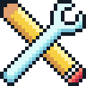
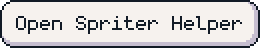
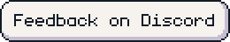
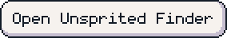
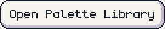

<picture><source media="(prefers-color-scheme: dark)" srcset="assets/readme/title-dark.svg"></picture>

Here's a collection of little and not-so-little tools to help you sprite for Pokémon Infinite Fusion

<a href="https://tullio-official.github.io/pif-spriter-helper/"><picture><source media="(prefers-color-scheme: dark)" srcset="assets/readme/btn-site-dark.svg"></picture></a>
<a href="https://discord.com/users/555046719406997552"><picture><source media="(prefers-color-scheme: dark)" srcset="assets/readme/btn-discord-dark.svg"></picture></a>

<h2><picture><source media="(prefers-color-scheme: dark)" srcset="assets/readme/unsprited-finder-dark.svg"></picture></h2>

A tool that shows random unsprited fusions for inspiration. It has a bunch of filters to help you narrow down your search.

<a href="https://tullio-official.github.io/pif-spriter-helper/unsprited-finder/"><picture><source media="(prefers-color-scheme: dark)" srcset="assets/readme/btn-unsprited-finder-dark.svg"></picture></a>

<h2><picture><source media="(prefers-color-scheme: dark)" srcset="assets/readme/palette-library-dark.svg"></picture></h2>

A library of all palettes used to sprite a Pokémon, including its base sprites and every fusion where it's the head.

<a href="https://tullio-official.github.io/pif-spriter-helper/palette-library/"><picture><source media="(prefers-color-scheme: dark)" srcset="assets/readme/btn-palette-library-dark.svg"></picture></a>

<h2><picture><source media="(prefers-color-scheme: dark)" srcset="assets/readme/feedback-dark.svg"></picture></h2>

Feel free to message me on Discord with any feedback or suggestions at [**tullio_official**](https://discord.com/users/555046719406997552).

<h2><picture><source media="(prefers-color-scheme: dark)" srcset="assets/readme/licence-dark.svg"></picture></h2>

The code is under the [MIT licence](LICENSE). All the assets except sprites are pixel art made by me and you can absolutely use them, just credit me ([CC BY 4.0](https://creativecommons.org/licenses/by/4.0/)). The fonts in [assets/fonts](assets/fonts) keep their own licences, and every sprite and palette belongs to the artist who made it.

---

Not directly affiliated with Pokémon Infinite Fusion Pokémon belongs to Nintendo, Creatures and Game Freak

